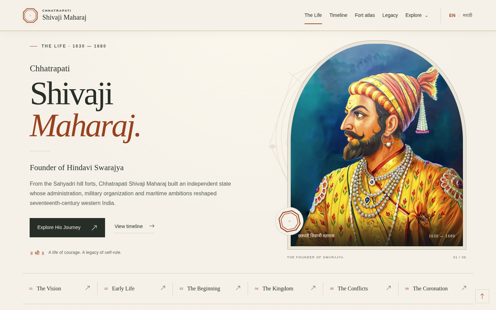
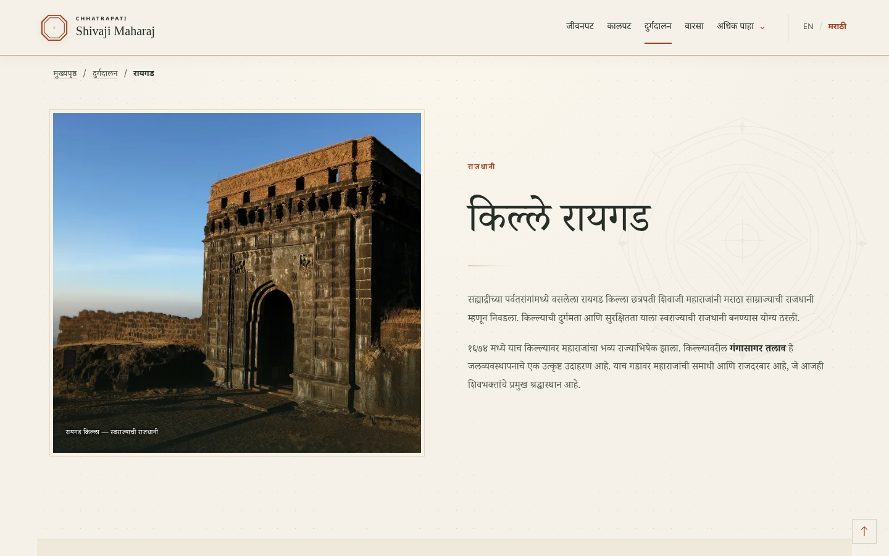
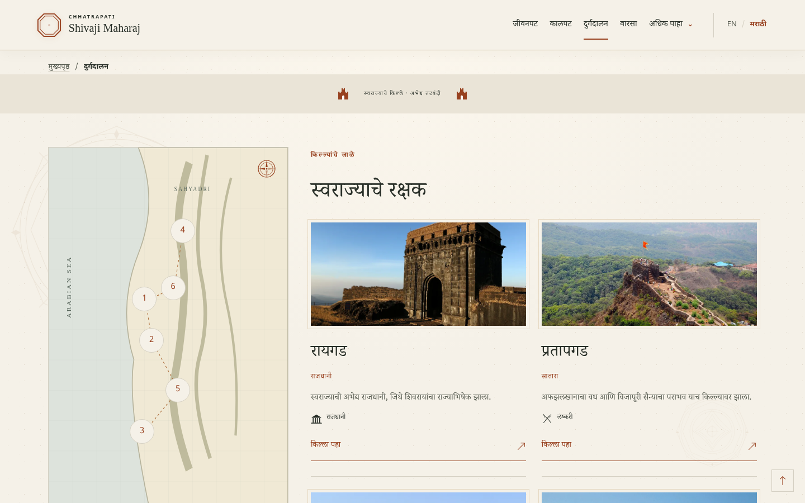
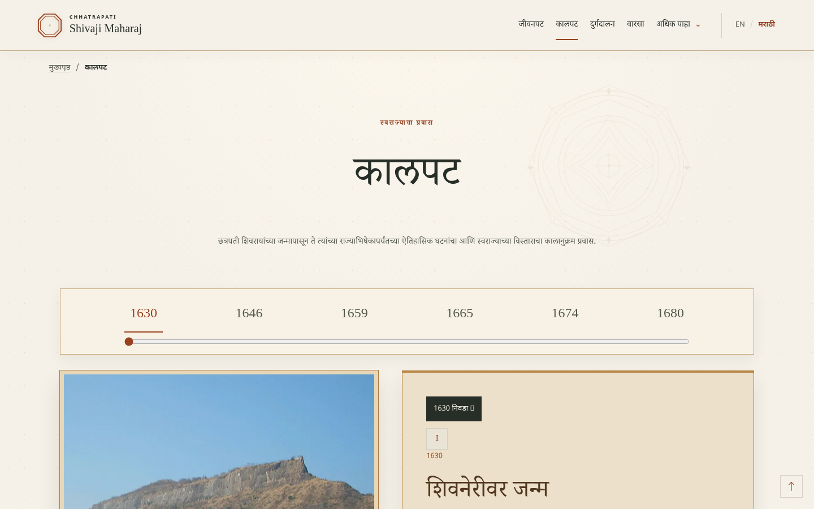
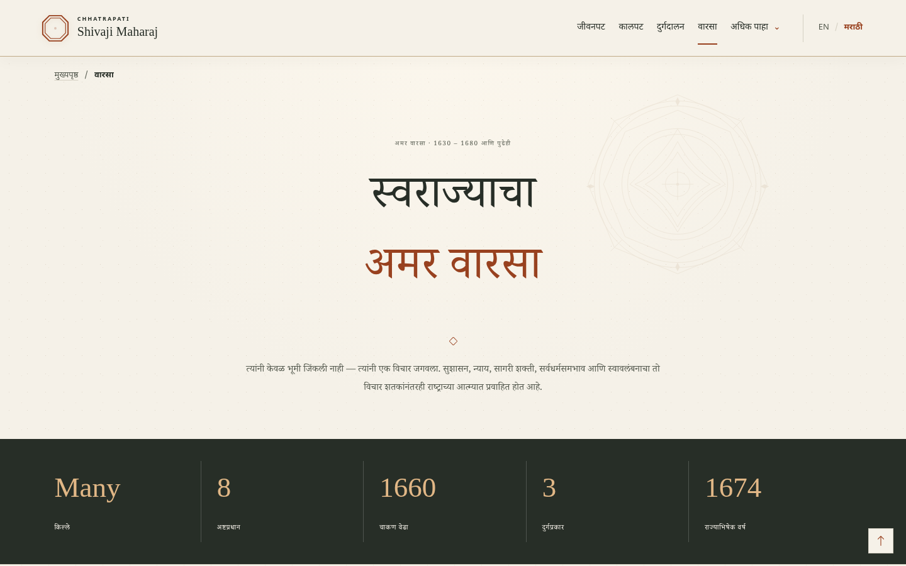
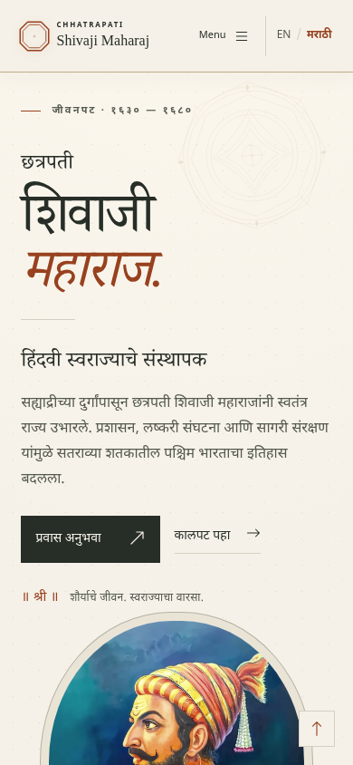
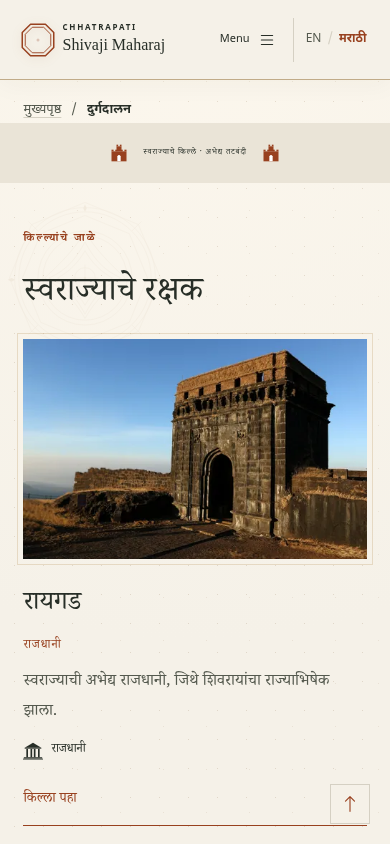
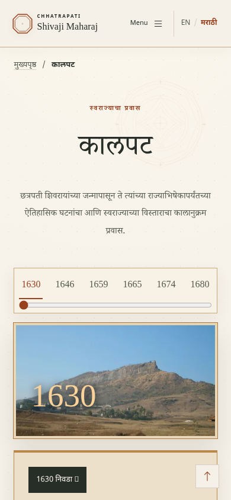
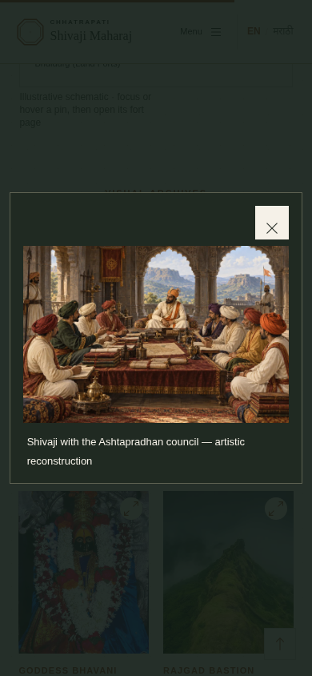
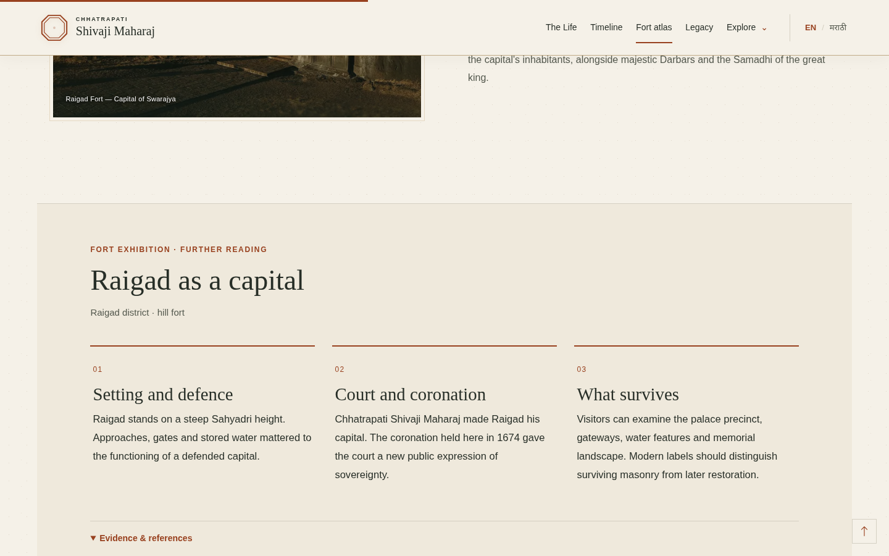

<div align="center">

<h1>Hindavi Swarajya</h1>

<p><strong>छत्रपती शिवाजी महाराज</strong><br>Chhatrapati Shivaji Maharaj</p>

<p>A digital heritage experience exploring a life, a landscape, and a lasting legacy.</p>

<p><code>English · मराठी</code> &nbsp; <code>13 page routes</code> &nbsp; <code>React 19 + Vite 6</code></p>

<p>
  <a href="https://atharv834.github.io/hindaviswarajya/"><strong>Explore the website ↗</strong></a>
  &nbsp; · &nbsp; <a href="#run-locally">Run locally</a>
  &nbsp; · &nbsp; <a href="#content--historical-approach">Historical approach</a>
  &nbsp; · &nbsp; <a href="#deployment">Deployment</a>
</p>

</div>



## About the project

**Hindavi Swarajya** is a bilingual heritage website dedicated to **Chhatrapati Shivaji Maharaj**. It brings together biographical chapters, an interactive timeline, fort exhibitions, commanders, the Southern Campaign, attributed sayings, and legacy in one connected reading experience.

The visual design combines the original painted portrait with architectural framing, a royal palette, fort photography, restrained motion, and generous reading layouts. English and Marathi share the same page routes, with an in-page language switch.

The application lives in **[`Shivaji Raje/`](./Shivaji%20Raje/)**. It builds to static files for hosting, with React rendering the historical content in the browser.

## Explore the collection

| Section | What you will find |
| :--- | :--- |
| [The Life](https://atharv834.github.io/hindaviswarajya/index.html) | The portrait-led introduction and linked life chapters |
| [Timeline](https://atharv834.github.io/hindaviswarajya/timeline.html) | Six milestones with keyboard controls, scene changes, and historical context |
| [Forts & Gallery](https://atharv834.github.io/hindaviswarajya/galleries.html) | An interactive schematic fort atlas and an accessible image gallery |
| **Six fort exhibitions** | [Raigad](https://atharv834.github.io/hindaviswarajya/fort-raigad.html), [Pratapgad](https://atharv834.github.io/hindaviswarajya/fort-pratapgad.html), [Shivneri](https://atharv834.github.io/hindaviswarajya/fort-shivneri.html), [Sindhudurg](https://atharv834.github.io/hindaviswarajya/fort-sindhudurg.html), [Sinhagad](https://atharv834.github.io/hindaviswarajya/fort-sinhagad.html), and [Panhala](https://atharv834.github.io/hindaviswarajya/fort-panhala.html), with bilingual context and expandable references |
| [Commanders](https://atharv834.github.io/hindaviswarajya/commanders.html) | People associated with the struggle for Swarajya |
| [The Southern Campaign](https://atharv834.github.io/hindaviswarajya/campaign.html) | The campaign narrative, regional setting, and editorial context |
| [Quotes & Sources](https://atharv834.github.io/hindaviswarajya/letters.html) | Attributed sayings, source material, and notes on authenticity |
| [Legacy](https://atharv834.github.io/hindaviswarajya/legacy.html) | Administration, military organization, maritime defence, and remembrance |

## Experience & design

- **Two languages:** English and Marathi, with a remembered language preference.
- **Connected reading:** Chapter links, breadcrumbs, reading progress, browser Back support, deep links, and reading-position restoration.
- **Interactive exhibits:** Timeline selection, fort atlas links, image dialogs, and expandable evidence panels.
- **Responsive layouts:** Mobile navigation, single-column fort cards on small screens, and responsive imagery.
- **Considered motion:** Scroll entrances and supporting landscape effects, with reduced-motion alternatives. The original main portrait remains intact.
- **Local interface assets:** An SVG icon sprite and no external font requests.
- **Production metadata:** Page-specific titles and descriptions, canonical links, structured data, a sitemap, and robots instructions.

## A closer look

### Forts, timeline & legacy

| Fort exhibition | Fort atlas & gallery |
| :---: | :---: |
| [](./audit/after/fort-raigad-1440-en-full.png) | [](./audit/after/galleries-1440-en-full.png) |
| **Raigad** — architecture, context, and further reading | **Forts & Gallery** — the atlas and visual collection |

| Interactive chronology | The legacy |
| :---: | :---: |
| [](./audit/after/timeline-1440-en-full.png) | [](./audit/after/legacy-1440-en-full.png) |
| **Timeline** — milestones and historical context | **Legacy** — institutions, defence, and remembrance |

Click a desktop preview to open its full-page capture.

### On a smaller screen

<table>
  <tr>
    <th>मराठी · Homepage</th>
    <th>Forts & Gallery</th>
    <th>Timeline</th>
  </tr>
  <tr>
    <td align="center"></td>
    <td align="center"></td>
    <td align="center"></td>
  </tr>
</table>

<details>
<summary><strong>Explore the interactions</strong></summary>

| Image gallery | Evidence & references |
| :---: | :---: |
|  |  |

These screenshots come from the existing local review captures. The [comparison record](./audit/COMPARISON.md) includes more viewports and before/after evidence.

</details>

## Run locally

**Requirements:** Node.js 20+ and npm.

Run all application commands from `Shivaji Raje/`, including the quotation marks around its name:

```sh
git clone https://github.com/Atharv834/hindaviswarajya.git
cd "hindaviswarajya/Shivaji Raje"
npm ci
npm run dev
```

Open the local address printed by Vite, normally **[127.0.0.1:5173](http://127.0.0.1:5173)**.

| Command | Purpose |
| :--- | :--- |
| `npm run dev` | Regenerate the icon sprite and start Vite |
| `npm run build` | Build all 13 HTML entry points, optimized assets, and SEO files into `dist/` |
| `npm run preview` | Serve the existing production build locally |
| `node scripts/migrate.mjs --content-only` | Regenerate content from the archived source pages |
| `node scripts/verify.mjs --content-only` | Check archived text against generated content |
| `npm test` | Run the main browser verification suite against a running server |

## Project guide

| Location | Responsibility |
| :--- | :--- |
| [`src/main.jsx`](./Shivaji%20Raje/src/main.jsx) | Shared layout, navigation, language state, and page rendering |
| [`src/museum.jsx`](./Shivaji%20Raje/src/museum.jsx) | Fort and campaign exhibition panels, references, and evidence notes |
| [`src/content/`](./Shivaji%20Raje/src/content/) | Generated page content, route manifest, image records, and credits |
| [`archive/`](./Shivaji%20Raje/archive/) | Editable source HTML for the content migration |
| [`src/styles.css`](./Shivaji%20Raje/src/styles.css) | Core responsive visual system |
| [`src/motion.jsx`](./Shivaji%20Raje/src/motion.jsx) and supporting CSS | Motion, layout refinements, and gallery details |
| [`public/images/`](./Shivaji%20Raje/public/images/) | Responsive WebP derivatives, generally at 480, 960, and 1600 pixels |
| [`scripts/`](./Shivaji%20Raje/scripts/) | Migration, image processing, icon generation, SEO, and checks |
| [`DESIGN-NOTES.md`](./Shivaji%20Raje/DESIGN-NOTES.md) | Design references, image decisions, and motion specifications |
| [`audit/`](./audit/) | Source ledger, baseline, comparison screenshots, measurements, and rollback guidance |

Original assets, styles, and older scripts are retained for reference; they are not the active production implementation.

## Content & historical approach

This is an educational heritage project. Its editorial approach distinguishes **established historical outlines, later traditions, attributed quotations, and unresolved claims**.

The [historical evidence ledger](./audit/SOURCE-LEDGER.md) records qualifications, corrections, and further verification needed. The exhibition panels reference works such as *Sabhasad Bakhar*, *Shivaji and His Times*, and the Maharashtra State Gazetteers series at the **work level**. These references are research starting points; they are not a claim that every passage has a verified manuscript or printed-page citation.

Popular sayings should not be treated as authenticated verbatim speech. The fort atlas is schematic, and generated scenes are artistic reconstructions.

### Editing workflow

1. Edit the corresponding English/Marathi text in [`archive/`](./Shivaji%20Raje/archive/).
2. From `Shivaji Raje/`, run `node scripts/migrate.mjs --content-only`.
3. Inspect the generated changes in `src/content/` and run the content check.
4. Edit separately maintained exhibition notes in `src/museum.jsx` where appropriate.
5. Review both languages, relevant source qualifications, and image credits before building.

Direct edits to migrated page JSON will be replaced the next time migration runs. A full `npm run migrate` also processes assets; use the content-only command for text changes.

## Verification

For the browser checks, install Google Chrome and keep the development server running on port **5173**:

```sh
# Terminal 1 — from Shivaji Raje/
npm run dev -- --port 5173 --strictPort
```

```sh
# Terminal 2 — from the same directory
node scripts/verify.mjs --content-only
npm test
node scripts/verify-motion.mjs
node scripts/verify-museum.mjs
node scripts/verify-a11y.mjs
npm run build
```

The main browser suite supports `TEST_URL` for a different server address; the accessibility script currently targets port 5173 directly.

Checks cover route loading, archive-to-content consistency, links, image references, English/Marathi layouts, timeline and atlas controls, gallery behavior, mobile navigation, keyboard interactions, focus, and motion.

Recorded results are in [`audit/COMPARISON.md`](./audit/COMPARISON.md). Automated accessibility checks support review but do not certify complete WCAG conformance. Local performance measurements are lab observations, not production Core Web Vitals or a public Lighthouse score.

## Deployment

The [GitHub Pages workflow](./.github/workflows/deploy-pages.yml) runs on pushes to **`main`** and manual dispatch. It installs dependencies, builds the site, runs content and browser checks, then publishes **`Shivaji Raje/dist/`**.

For another static host:

```sh
# From Shivaji Raje/
npm ci
npm run build
```

Publish the contents of `dist/`. All 13 `.html` routes are built as entry points, so ordinary static hosting needs no SPA fallback rewrite. Vite uses relative asset paths for subdirectory hosting.

If the public address changes, update the canonical origin in [`scripts/write-seo.mjs`](./Shivaji%20Raje/scripts/write-seo.mjs) and rebuild.

## Images, attribution & reuse

The site combines fort photographs, sourced artifacts, interpretive diagrams, and seven generated illustrations alongside its original hero portrait. Generated scenes are labelled as artistic reconstructions; image credits preserve source links, creators, licence details, and recorded transformations.

- [Image credit records](./Shivaji%20Raje/src/content/credits.json)
- [Curated photograph records](./Shivaji%20Raje/assets/curated/photo-credits.json)
- [Licensing and attribution](./LICENSES.md)

**No repository-wide code or text licence is declared.** Individual asset licences apply to those assets; Bootstrap Icons' MIT licence does not license the entire project. Confirm the relevant rights before reusing code, text, photographs, or illustrations.

## Contributing

For a correction, include the page, affected passage, supporting source, and its page or folio locator when available. Preserve historical qualifications and update both languages. For interface work, include desktop/mobile evidence and run the relevant checks.

Maintained by [Atharv834](https://github.com/Atharv834).

---

<p align="center"><strong>History, landscape, and legacy — brought together for thoughtful exploration.</strong></p>
